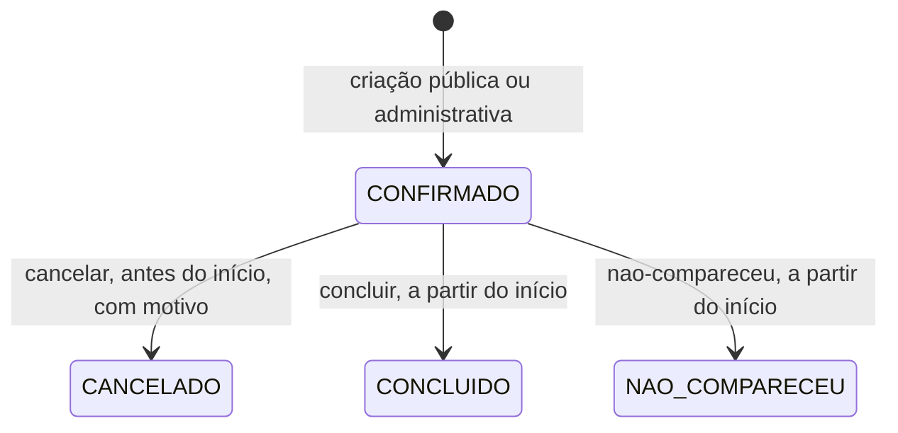

# Guia do frontend

Este guia explica a sequência e as regras para consumir a API V1. A estrutura de
cada requisição e resposta está no OpenAPI; os códigos de erro estão em
[catalogo-erros.md](catalogo-erros.md); os exemplos executáveis estão em
[catalogo-api.http](catalogo-api.http).

## Contrato

- OpenAPI em JSON: `GET /api-docs`. Interface navegável: `/swagger-ui.html`.
- No perfil `prod`, ambos ficam desabilitados por padrão; habilite com
  `OPENAPI_HABILITADA=true` e `SWAGGER_UI_HABILITADA=true` somente onde fizer sentido.
- Cada operação declara `x-papeis` e repete os papéis em `description`:
  `PUBLICO` (sem sessão), `AUTENTICADO` (qualquer sessão, inclusive com senha
  temporária), `PROPRIETARIO` e `FUNCIONARIO`.
- JSON usa nomes em português sem acentos. Identificadores são UUID.

## Datas, horários e dinheiro

- Instantes usam ISO 8601 com offset do fuso da instalação, por exemplo
  `2026-10-19T09:00:00-03:00`. O fuso também vem em `fusoHorario`.
- Datas de consulta (`dataInicial`, `dataFinal`) são datas locais inclusivas, com no
  máximo 31 datas por chamada.
- Horários do expediente usam `HH:mm` locais.
- Preços têm duas casas decimais e acompanham a moeda (`moeda` ou `moedaContratada`).

## Sessão e CSRF

A administração usa sessão HTTP com cookie, não token. O frontend deve ser servido
na mesma origem da API, pois CORS está desabilitado.

1. `GET /api/v1/administracao/autenticacao/csrf` devolve `token` e grava o cookie
   `CSRF-TOKEN`.
2. Toda operação mutável, inclusive `entrar`, envia o token no cabeçalho
   `X-CSRF-TOKEN`. Sem ele a resposta é `403 FALHA_VALIDACAO_CSRF`.
3. `POST /autenticacao/entrar` com email e senha cria a sessão (`JSESSIONID`,
   `HttpOnly`). Credenciais erradas retornam `401 AUTENTICACAO_NECESSARIA`; falhas
   repetidas retornam `429 LIMITE_TENTATIVAS_LOGIN` com `Retry-After`.
4. O mesmo token continua válido depois do login. Obtenha outro somente ao receber
   `403 FALHA_VALIDACAO_CSRF`, por exemplo depois de limpar cookies.
5. `GET /autenticacao/eu` informa nome, papel, `profissionalId` e
   `deveAlterarSenha`. Use-o para montar a navegação.
6. Com `deveAlterarSenha=true`, só `eu`, `senha` e `sair` funcionam; as demais
   rotas retornam `403 ACESSO_NEGADO`. Leve o usuário direto à troca de senha.
7. `PUT /autenticacao/senha` encerra todas as sessões do usuário; peça novo login.
8. A sessão expira após 30 minutos sem uso e também ao reiniciar a API. Trate
   qualquer `401` em rota administrativa voltando ao login.

Detalhes de bootstrap, recuperação e contas estão em
[autenticacao-administrativa.md](autenticacao-administrativa.md).

## Papéis e escopo

| Área | `PROPRIETARIO` | `FUNCIONARIO` |
|---|---|---|
| usuários, profissionais, clientes e anonimização | sim | não (`403`) |
| recursos | gerencia | só lista |
| serviços, expediente, bloqueios e reservas | todos os profissionais | só o profissional vinculado |

Para `FUNCIONARIO`, o profissional vem da sessão. Filtros com outro `profissionalId`
são ignorados nas consultas, e entidades de outro profissional respondem `404`, sem
confirmar que existem. Em comandos de serviço e agenda, o `FUNCIONARIO` pode omitir
`profissionalId`; se enviar outro profissional, recebe `403 ACESSO_NEGADO`. Para
`PROPRIETARIO`, `profissionalId` é obrigatório nesses comandos e nas consultas de
agenda (`422 PROFISSIONAL_OBRIGATORIO`).

## Fluxo público de reserva

A superfície pública termina na criação: não existe consulta, cancelamento,
reagendamento, token ou referência pública da reserva. Alterações posteriores
dependem de contato com o negócio, e a interface deve dizer isso ao cliente.

1. `GET /api/v1/publico/servicos` lista serviços ativos com seu profissional.
2. `GET /api/v1/publico/servicos/{id}/disponibilidade` devolve os horários
   livres. Ofereça somente esses `inicioEm`; a lista é uma fotografia, não uma
   reserva.
3. Colete somente nome e celular. O celular aceita formatação brasileira comum, com
   ou sem `+55`.
4. `GET /api/v1/publico/aviso-privacidade` devolve `versao` e `texto`. Mostre o
   texto no resumo e peça a ciência.
5. Gere uma `Chave-Idempotencia` nova para essa confirmação (um UUID serve) e
   envie `POST /api/v1/publico/agendamentos` com `versaoAvisoPrivacidade` igual à
   versão exibida e `cienteAvisoPrivacidade: true`.
6. `201` traz estado `CONFIRMADO`, serviço, profissional, início, fim, fuso, preço e
   moeda. Não há `Location` nem identificador.

### Retentativas e conflitos

| Situação | O que fazer |
|---|---|
| timeout, queda de rede ou `500` | repetir com a **mesma** chave e o mesmo conteúdo; a API devolve o `201` original sem duplicar a reserva por 24 horas |
| `409 CONFLITO_AGENDAMENTO` | o horário foi ocupado; recarregar a disponibilidade, manter nome e celular e usar **nova** chave na próxima escolha |
| `409 AVISO_PRIVACIDADE_DESATUALIZADO` | buscar o aviso de novo, reapresentar e pedir nova ciência |
| `409 CONFLITO_IDEMPOTENCIA` | a chave foi reaproveitada com outro conteúdo; gerar nova chave |
| `422 FALHA_VALIDACAO` | destacar `errosCampos` e permitir correção |
| `429 LIMITE_REQUISICOES_PUBLICAS` | aguardar `Retry-After` |

Nunca afirme que a reserva foi criada sem um `201`. Falhas de validação, conflito
ou erro inesperado não consomem a chave.

## Operação administrativa de reservas

`GET /api/v1/administracao/agendamentos` lista por período e aceita `profissionalId`
e `estado`. Todas as rotas de reserva devolvem a mesma representação, com cliente,
fotografias contratadas, recursos alocados e auditoria (`criadoPor`,
`estadoAlteradoEm`, `estadoAlteradoPor`, `motivoCancelamento`).

A criação administrativa usa o mesmo corpo e as mesmas regras de idempotência da
pública, mais sessão e CSRF. Ela aceita horários dentro da antecedência mínima e
além do horizonte públicos, mas recusa início no passado (`422 INICIO_NO_PASSADO`)
e continua respeitando expediente, bloqueios, ocupação e capacidade. O usuário
confirma que o cliente teve ciência do aviso vigente.

### Estados

`CANCELADO`, `CONCLUIDO` e `NAO_COMPARECEU` são finais. Só `CONFIRMADO` ocupa
agenda e capacidade; o cancelamento libera o horário imediatamente. Fora do estado
ou da janela, a resposta é `409 TRANSICAO_AGENDAMENTO_INVALIDA`. Não existe
confirmação manual, rejeição ou reagendamento: para mudar o horário, cancele e
crie outra reserva.

## Clientes e anonimização

Somente `PROPRIETARIO` consulta `GET /api/v1/administracao/clientes/{id}`, usando o
`cliente.id` de uma reserva. A anonimização (`POST .../anonimizar`) exige motivo,
é recusada com `409 CLIENTE_POSSUI_RESERVA_FUTURA` enquanto houver reserva
`CONFIRMADO` futura, e remove nome e celular do cadastro e das reservas, que passam a
exibir `null`. O motivo fica registrado com autor e instante; não escreva dados
pessoais nele.

A verificação de identidade de quem pede a anonimização, a base legal e o texto do
aviso de privacidade são responsabilidade da instalação; a API não os decide.

## Erros

Todas as falhas seguem RFC 9457. Decida pelo `status` e pelo `codigo`, nunca pelo
texto. Mostre o `idRastreio` em mensagens de falha inesperada para facilitar o
suporte. A lista completa e a ação esperada estão em
[catalogo-erros.md](catalogo-erros.md).
