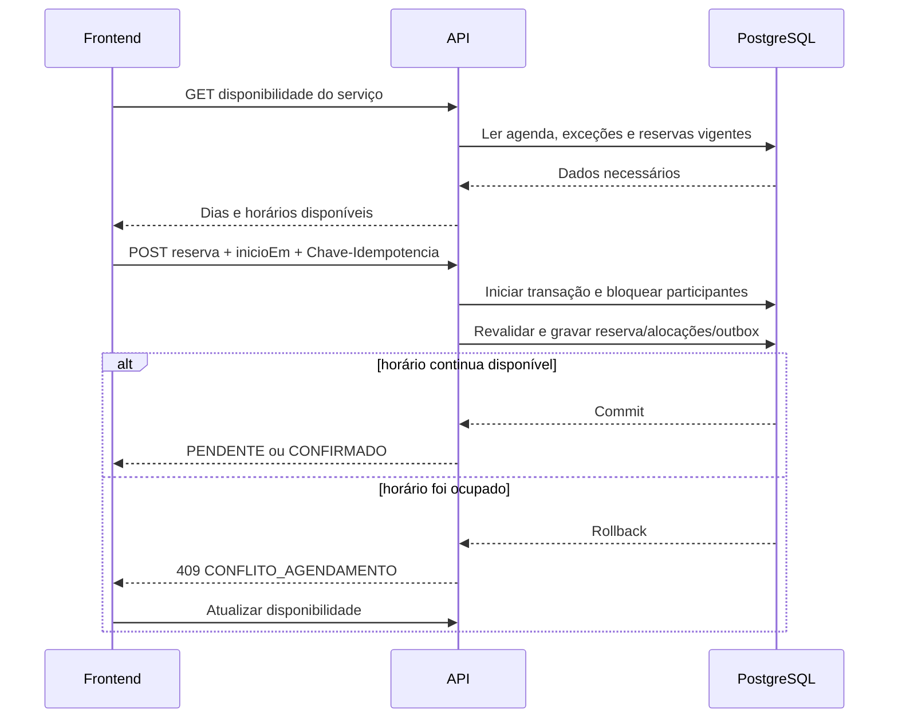

# Persistência da agenda e disponibilidade

## Objetivo

Definir como horários de trabalho, bloqueios e reservas são armazenados e como o frontend obtém um calendário seguro. Este documento detalha D-007, D-009, D-015, D-017 e D-022 sem introduzir unidades de grade persistidas.

## Fonte de verdade

O PostgreSQL é a autoridade sobre disponibilidade. O frontend recebe opções calculadas pela API e nunca decide sozinho que um horário está livre.

Uma consulta de disponibilidade é uma fotografia momentânea. Ela não cria bloqueio temporário. A criação da reserva repete todas as verificações dentro de uma transação, porque outra requisição pode ocupar o intervalo antes da confirmação.

## Informações persistidas

| Informação | Persistência conceitual | Observação |
|---|---|---|
| configuração | `ConfiguracaoNegocio` | fuso, grade, confirmação, prazo de pendência e limites públicos |
| expediente semanal | `ExpedienteSemanal` | dia da semana, início e fim locais; pertence a um profissional ou recurso |
| exceção de agenda | `ExcecaoAgenda` | `ABERTURA` adiciona período extraordinário; `BLOQUEIO` remove e prevalece |
| serviço | `Servico` | profissional, duração e intervalo de limpeza em minutos |
| recursos padrão | `PredefinicaoRecursoServico` | recurso, quantidade padrão e mínimo obrigatório usados para montar a reserva |
| reserva | `Agendamento` | cliente, serviço, profissional, instantes, estado e fotografias históricas |
| alocação | `AlocacaoRecursoAgendamento` | recurso e quantidade efetivamente reservada |

`ExpedienteSemanal` e `ExcecaoAgenda` possuem exatamente um proprietário: `profissionalId` ou `recursoOperacionalId`. A implementação deve usar chaves estrangeiras e uma restrição que impeça ambos vazios ou ambos preenchidos.

## Intervalos da reserva

A API recebe somente `servicoId` e `inicioEm`; o cliente não escolhe duração nem término.

Ao criar a reserva, a API calcula e persiste:

- `inicioEm`: início escolhido;
- `fimServicoEm = inicioEm + duracaoContratadaMinutos`;
- `ocupadoAte = fimServicoEm + intervaloLimpezaRegistradoMinutos`.

O cliente vê o intervalo de `inicioEm` até `fimServicoEm`. O profissional e os recursos ficam indisponíveis no intervalo semiaberto `[inicioEm, ocupadoAte)`. Intervalos adjacentes são permitidos: uma reserva pode começar exatamente em `ocupadoAte` da anterior.

Instantes são persistidos em UTC com `timestamptz`. Expedientes recorrentes usam dia da semana e hora local. O cálculo converte usando o fuso IANA da instalação e a resposta pública inclui offset.

## Cálculo da disponibilidade

Para cada serviço e período solicitado, a API:

1. carrega o serviço ativo, seu profissional e as alocações padrão aplicáveis, validando seus mínimos;
2. calcula a duração ocupada usando as fotografias que uma nova reserva receberia;
3. monta candidatos alinhados a `intervaloGradeMinutos` no fuso da instalação;
4. mantém apenas candidatos totalmente contidos no expediente do profissional;
5. cruza os expedientes de todos os recursos necessários;
6. aplica exceções `ABERTURA` e remove qualquer trecho coberto por `BLOQUEIO` no profissional ou nos recursos;
7. remove intervalos que sobreponham reservas `CONFIRMADO` ou `PENDENTE` ainda válidas do profissional;
8. para cada recurso, soma quantidades de alocações sobrepostas e mantém o candidato somente quando a capacidade restante atende à quantidade solicitada;
9. aplica antecedência mínima de 60 minutos e horizonte de 90 dias por padrão, usando os valores configurados;
10. agrupa os horários restantes por data local e os devolve ordenados.

Reservas `CANCELADO`, `EXPIRADO`, `CONCLUIDO` e `NAO_COMPARECEU` não bloqueiam novos horários. Antes do cálculo, pendências vencidas relevantes são promovidas idempotentemente para `EXPIRADO`.

## Contrato usado pelo calendário

O frontend consulta:

`GET /api/v1/publico/servicos/{servicoId}/disponibilidade?dataInicial=YYYY-MM-DD&dataFinal=YYYY-MM-DD`

Resposta conceitual:

```json
{
  "servicoId": "01J...",
  "fusoHorario": "America/Sao_Paulo",
  "dataInicial": "2026-10-10",
  "dataFinal": "2026-10-16",
  "dias": [
    {
      "data": "2026-10-10",
      "horarios": [
        {
          "inicioEm": "2026-10-10T09:00:00-03:00",
          "fimServicoEm": "2026-10-10T10:00:00-03:00"
        },
        {
          "inicioEm": "2026-10-10T10:15:00-03:00",
          "fimServicoEm": "2026-10-10T11:15:00-03:00"
        }
      ]
    }
  ]
}
```

O frontend segue estas regras:

- dia sem entrada em `dias`, ou com `horarios` vazio, aparece indisponível;
- somente valores de `inicioEm` retornados podem ser selecionados;
- a seleção visual não representa reserva nem bloqueio no servidor;
- o frontend não baixa reservas de outros clientes e não reconstrói disponibilidade;
- após criar, cancelar ou reagendar, o calendário consulta a disponibilidade novamente;
- ao receber `409 CONFLITO_AGENDAMENTO`, informa que o horário acabou de ser ocupado, preserva os dados permitidos do formulário e atualiza os horários.

O frontend envia o `inicioEm` escolhido e uma `Chave-Idempotencia` ao criar a reserva. A mesma chave é reutilizada somente se essa tentativa precisar ser repetida. A API ignora qualquer término calculado pelo navegador e usa as durações vigentes do serviço.

## Criação atômica da reserva

Dentro de uma única transação, a aplicação:

1. bloqueia a linha do profissional;
2. bloqueia as linhas dos recursos necessários em ordem crescente de identificador;
3. encerra pendências vencidas relevantes;
4. revalida serviço, grade, expediente, exceções, sobreposição e capacidades;
5. localiza ou cria o cliente;
6. grava `Agendamento`, fotografias e alocações;
7. grava o evento de outbox aplicável;
8. confirma a transação.

O bloqueio das linhas no PostgreSQL serializa somente reservas que disputam o mesmo profissional ou recurso e funciona mesmo se futuramente houver mais de uma instância da aplicação. A ordem fixa dos recursos reduz risco de deadlock.

Se qualquer validação falhar, nenhuma parte é persistida. Um conflito de ocupação retorna `409 CONFLITO_AGENDAMENTO`. Repetir a mesma solicitação e a mesma chave idempotente devolve o resultado original.

## Visão do fluxo



## Índices e garantias mínimas

- índice em `Agendamento(profissionalId, inicioEm, ocupadoAte, estado)`;
- índice em `AlocacaoRecursoAgendamento(recursoOperacionalId, agendamentoId)`;
- índice para localizar pendências por `estado` e `expiraEm`;
- unicidade da referência pública e da chave de idempotência no escopo definido;
- checks para intervalos positivos, quantidades positivas e `inicioEm < fimServicoEm <= ocupadoAte`;
- testes concorrentes com PostgreSQL real para profissional, recurso unitário e última unidade de recurso com capacidade maior que um.

Os horários oferecidos não são tabelas nem registros. São opções derivadas da agenda, da grade, da duração e das ocupações existentes.
