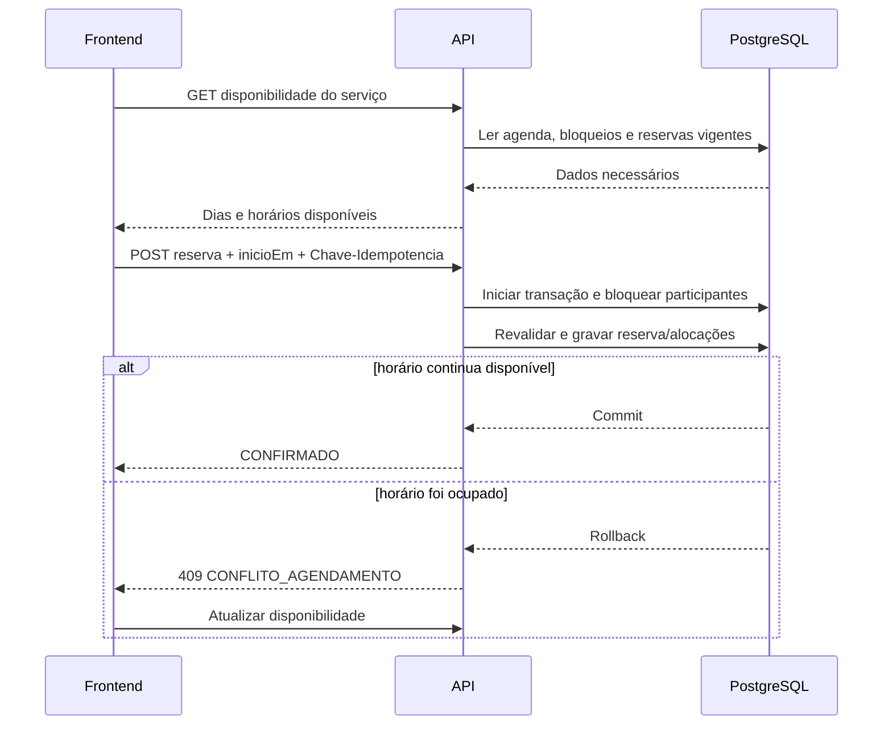

# Persistência da agenda e disponibilidade

## Objetivo

Definir como horários de trabalho, bloqueios e reservas são armazenados e como o frontend obtém um calendário seguro. A V1 usa confirmação automática, agenda exclusiva do profissional e quantidades fixas de recursos por serviço, sem introduzir unidades de grade persistidas.

## Recorte de B2

B2 persiste somente expediente semanal e bloqueios e entrega disponibilidade sem
reservas. `Agendamento`, `AlocacaoRecursoAgendamento`, idempotência, locks e
revalidação transacional pertencem a B3. Não se cria porta ou implementação vazia de
ocupações em B2.

## Fonte de verdade

O PostgreSQL é a autoridade sobre disponibilidade. O frontend recebe opções calculadas pela API e nunca decide sozinho que um horário está livre.

Uma consulta de disponibilidade é uma fotografia momentânea. Ela não cria bloqueio temporário. A criação da reserva repete todas as verificações dentro de uma transação, porque outra requisição pode ocupar o intervalo antes da confirmação.

## Informações persistidas

| Informação | Persistência conceitual | Observação |
|---|---|---|
| configuração | `ConfiguracaoNegocio` | fuso, grade e limites da criação pública |
| expediente semanal | `ExpedienteSemanal` | dia da semana, início e fim locais; pertence a um profissional |
| bloqueio de agenda | `BloqueioAgenda` | intervalo indisponível pertencente a um profissional |
| serviço | `Servico` | profissional, duração e intervalo de limpeza em minutos |
| requisitos de recursos | `RequisitoRecursoServico` | recurso e quantidade positiva fixa usada em toda reserva do serviço |
| reserva | `Agendamento` | persistida em B3 com cliente, serviço, profissional, instantes, estado e fotografias |
| alocação | `AlocacaoRecursoAgendamento` | persistida em B3 como fotografia automática e não editável |

Recursos operacionais possuem capacidade, mas não possuem expediente ou bloqueios próprios. Sua disponibilidade resulta do estado ativo, da capacidade e das alocações sobrepostas. A quantidade exigida pelo serviço não pode ser alterada na criação nem depois dela, e uma alocação não pode ser editada, removida, acrescentada ou realocada.

## Intervalos da reserva

A API recebe somente `servicoId` e `inicioEm`; o cliente não escolhe duração nem término.

Ao criar a reserva, a API calcula e persiste:

- `inicioEm`: início escolhido;
- `fimServicoEm = inicioEm + duracaoContratadaMinutos`;
- `ocupadoAte = fimServicoEm + intervaloLimpezaRegistradoMinutos`.

O cliente vê o intervalo de `inicioEm` até `fimServicoEm`. O profissional e os recursos ficam indisponíveis no intervalo semiaberto `[inicioEm, ocupadoAte)`. Intervalos adjacentes são permitidos: uma reserva pode começar exatamente em `ocupadoAte` da anterior.

Instantes são persistidos em UTC com `timestamptz`. Expedientes recorrentes usam dia da semana e hora local. O cálculo converte usando o fuso IANA da instalação e a resposta pública inclui offset.

O expediente de um profissional é uma representação integral de janelas no mesmo
dia local. `PUT` substitui o conjunto atomicamente; lista vazia limpa a agenda.
Janelas e bloqueios usam intervalos semiabertos, aceitam adjacência e rejeitam
sobreposição dentro do mesmo tipo e profissional. Bloqueios não possuem motivo.

## Cálculo da disponibilidade

Para cada serviço e período solicitado, a API:

1. carrega o serviço ativo, seu profissional e seus requisitos fixos de recursos;
2. calcula a duração ocupada usando as fotografias que uma nova reserva receberia;
3. monta candidatos alinhados a `intervaloGradeMinutos` no fuso da instalação;
4. mantém apenas candidatos totalmente contidos no expediente do profissional;
5. remove qualquer trecho coberto por bloqueio do profissional;
6. confirma que todos os recursos exigidos estão ativos e possuem capacidade nominal suficiente;
7. aplica antecedência mínima de 60 minutos e horizonte de 90 dias por padrão, usando os valores configurados;
8. agrupa os horários restantes por data local e os devolve ordenados.

B3 acrescenta a remoção de reservas `CONFIRMADO` sobrepostas e a soma das alocações
confirmadas de recursos. Essa extensão não altera a rota nem a resposta pública.

Reservas `CANCELADO`, `CONCLUIDO` e `NAO_COMPARECEU` não bloqueiam novos horários.

## Contrato usado pelo calendário

O frontend consulta:

`GET /api/v1/publico/servicos/{servicoId}/disponibilidade?dataInicial=YYYY-MM-DD&dataFinal=YYYY-MM-DD`

As duas datas são locais, inclusivas e obrigatórias. Uma consulta contém no máximo
31 datas. Períodos válidos sem opções retornam `dias` vazio; limites de antecedência
e horizonte filtram opções, sem recortar silenciosamente o período informado.

Resposta conceitual:

```json
{
  "servicoId": "01J...",
  "fusoHorario": "America/Sao_Paulo",
  "dataInicial": "2026-10-10",
  "dataFinal": "2026-10-16",
  "dias": [
    {
      "data": "2026-10-10",
      "horarios": [
        {
          "inicioEm": "2026-10-10T09:00:00-03:00",
          "fimServicoEm": "2026-10-10T10:00:00-03:00"
        },
        {
          "inicioEm": "2026-10-10T10:15:00-03:00",
          "fimServicoEm": "2026-10-10T11:15:00-03:00"
        }
      ]
    }
  ]
}
```

O frontend segue estas regras:

- dia sem entrada em `dias`, ou com `horarios` vazio, aparece indisponível;
- somente valores de `inicioEm` retornados podem ser selecionados;
- a seleção visual não representa reserva nem bloqueio no servidor;
- o frontend não baixa reservas de outros clientes e não reconstrói disponibilidade;
- após uma criação ou um conflito, o frontend público consulta a disponibilidade novamente;
- ao receber `409 CONFLITO_AGENDAMENTO`, informa que o horário acabou de ser ocupado, preserva os dados permitidos do formulário e atualiza os horários.

O frontend envia o `inicioEm` escolhido e uma `Chave-Idempotencia` ao criar a reserva. A mesma chave é reutilizada somente se essa tentativa precisar ser repetida. A API ignora qualquer término calculado pelo navegador e usa as durações vigentes do serviço.

## Extensão de B3: criação atômica da reserva

Dentro de uma única transação, a aplicação:

1. bloqueia a linha do profissional;
2. bloqueia as linhas dos recursos necessários em ordem crescente de identificador;
3. revalida serviço, grade, expediente e bloqueios do profissional, sobreposição e capacidades;
4. localiza ou cria o cliente;
5. grava `Agendamento` como `CONFIRMADO`, fotografias e alocações automáticas com as quantidades fixas do serviço;
6. confirma a transação.

O bloqueio das linhas no PostgreSQL serializa somente reservas que disputam o mesmo profissional ou recurso e funciona mesmo se futuramente houver mais de uma instância da aplicação. A ordem fixa dos recursos reduz risco de deadlock.

Se qualquer validação falhar, nenhuma parte é persistida. Um conflito de ocupação retorna `409 CONFLITO_AGENDAMENTO`. Repetir a mesma criação pública e a mesma chave idempotente devolve o resultado original. Criações públicas e administrativas sempre resultam em `CONFIRMADO`.

## Visão do fluxo



## Índices e garantias mínimas

- índice em `ExpedienteSemanal(profissionalId, diaSemana, inicio)`;
- índice em `BloqueioAgenda(profissionalId, inicioEm, fimEm)`;
- checks de início anterior ao fim para expediente e bloqueio;
- substituição integral de expediente e criação de bloqueio serializadas pelo profissional;
- as garantias seguintes pertencem a B3:
- índice em `Agendamento(profissionalId, inicioEm, ocupadoAte, estado)`;
- índice em `AlocacaoRecursoAgendamento(recursoOperacionalId, agendamentoId)`;
- unicidade da chave de idempotência da criação pública no escopo definido;
- unicidade da associação entre serviço e recurso e quantidade fixa positiva não superior à capacidade;
- checks para intervalos positivos, quantidades positivas e `inicioEm < fimServicoEm <= ocupadoAte`;
- alocações criadas somente como fotografia automática dos requisitos do serviço, sem operação de edição ou realocação;
- testes concorrentes com PostgreSQL real para profissional, recurso unitário e última unidade de recurso com capacidade maior que um.

Os horários oferecidos não são tabelas nem registros. São opções derivadas da agenda, da grade, da duração e das ocupações existentes.
